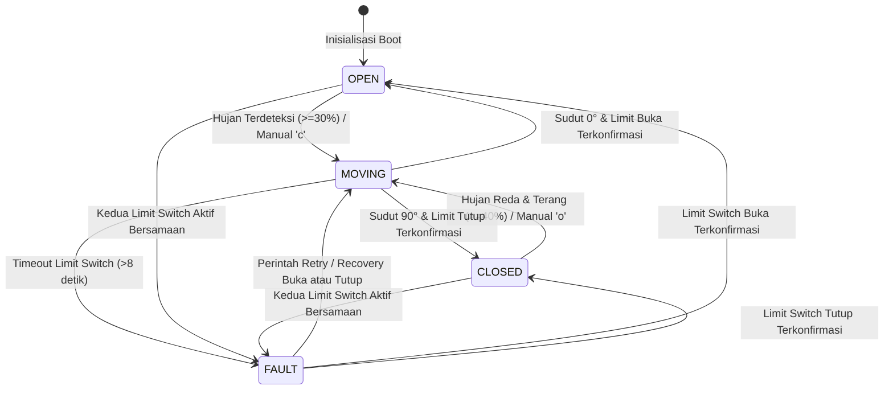

# FishSlide: Sistem Penutup Geser Otomatis pada Area Penjemuran Ikan Berbasis IoT — Kelompok 16

Proyek mata kuliah **Teknologi IoT**, Program Studi S1 Informatika, Fakultas Teknik, Universitas Bengkulu.
**Pengembang:** Tim IoT Kelompok 16

---

## 1. Deskripsi Sistem

**FishSlide** adalah sistem otomatisasi penutup geser (*sliding cover*) untuk area penjemuran ikan tradisional berbasis mikrokontroler **ESP32**, dikembangkan oleh **Kelompok 16**. Sistem ini memantau kondisi cuaca secara *real-time* (tingkat kebasahan/hujan dan intensitas cahaya matahari) untuk melindungi komoditas ikan dari air hujan secara otonom, membuka kembali penutup saat cuaca kembali panas terik, serta menyediakan opsi kendali manual jarak jauh melalui protokol **MQTT** dan antarmuka **Serial**.

---

## 2. Arsitektur Sistem & Spesifikasi Komponen

```
                  +-----------------------------------+
                  |        ESP32 DevKit V1            |
                  |                                   |
[Potensio/Hujan] -> GPIO 34 (ADC1_CH6)                |
[LDR / Cahaya]   -> GPIO 35 (ADC1_CH7)                |
[Limit Buka]     -> GPIO 25 (INPUT_PULLUP)            |
[Limit Tutup]    -> GPIO 26 (INPUT_PULLUP)            |
                  |                                   |
                  |   GPIO 18 (PWM) -> [Servo SG90]   |
                  |   GPIO 27 (OUT) -> [LED Kuning]   |
                  +--------+-----------------+--------+
                           |                 |
                   Wi-Fi / MQTT         HTTP POST
                           |                 |
               [broker.hivemq.com]   [httpbin.org / API]
```

### Pemetaan Pin GPIO

| Komponen | Pin ESP32 | Mode Pin | Deskripsi Fungsi |
| :--- | :--- | :--- | :--- |
| **Simulasi Sensor Hujan (Potensiometer)** | `GPIO 34` | Analog (ADC1) | Skala 0–4095 dipetakan ke 0–100% intensitas hujan |
| **Sensor Cahaya (LDR Module)** | `GPIO 35` | Analog (ADC1) | Skala 0–4095 dipetakan ke 0–100% tingkat terang |
| **Motor Servo (SG90 / Actuator)** | `GPIO 18` | PWM Timer 0 | Penggerak mekanik rak: `0°` (Terbuka), `90°` (Tertutup) |
| **Limit Switch Terbuka (Hijau)** | `GPIO 25` | `INPUT_PULLUP` | Mendeteksi batas akhir rel posisi terbuka (*Active LOW*) |
| **Limit Switch Tertutup (Merah)** | `GPIO 26` | `INPUT_PULLUP` | Mendeteksi batas akhir rel posisi tertutup (*Active LOW*) |
| **LED Status Indikator** | `GPIO 27` | Output Digital | Indikasi visual status (Mati/Menyala/Kedip) |

---

## 3. Logika & State Machine

Sistem menerapkan mesin keadaan (*finite state machine*) dengan 4 status utama:



### Ambang Batas Logika Operasional
* **Deteksi Hujan:** Hujan aktif jika `rain_pct >= 30%` $\rightarrow$ Servo bergerak menutup ke `90°`.
* **Histeresis & Stabilisasi Reda:** Hujan dinyatakan mereda jika `rain_pct <= 20%` dan stabil bertahan selama minimal **5000 ms** (`RAIN_CLEAR_MS`).
* **Pembukaan Otomatis:** Setelah hujan berhenti dan cuaca terik (`light_pct >= 40%`) $\rightarrow$ Servo membuka ke `0°`.
* **Deteksi Gangguan (Fault Protection):**
  * Jika kedua limit switch tertekan secara bersamaan $\rightarrow$ status seketika `FAULT`.
  * Jika servo telah mencapai target sudut tetapi limit switch tidak tertekan dalam **8000 ms** (`LIMIT_TIMEOUT_MS`) $\rightarrow$ status beralih ke `FAULT`.
* **Indikator Visual LED:**
  * `OPEN` : LED Padam.
  * `CLOSED` : LED Menyala konstan.
  * `MOVING` : LED Berkedip lambat (interval 300 ms).
  * `FAULT` : LED Berkedip cepat (interval 100 ms).

---

## 4. Protokol Komunikasi & Format Data

### Topik MQTT Resmi Kelompok 16 (`broker.hivemq.com:1883`)
Base topic: `unib/fishslide/kelompok16/node01`
* **Telemetri Berkala (1 detik):** `unib/fishslide/kelompok16/node01/telemetry`
* **Event & Perubahan Status:** `unib/fishslide/kelompok16/node01/event`
* **Status Perangkat (LWT Retained):** `unib/fishslide/kelompok16/node01/status` (`online` / `offline`)
* **Perintah Kendali:** `unib/fishslide/kelompok16/node01/cmd`
  * Payload yang didukung: `"open"` (atau `"o"`), `"close"` (atau `"c"`), `"auto"` (atau `"a"`).

### Contoh Payload Telemetri (JSON)
```json
{
  "device_id": "fishslide-node01",
  "type": "telemetry",
  "seq": 142,
  "uptime_ms": 145230,
  "mode": "AUTO",
  "sensor": {
    "rain_raw": 3200,
    "rain_pct": 78,
    "ldr_raw": 820,
    "light_pct": 80,
    "raining": true
  },
  "cover": {
    "status": "CLOSED",
    "servo_angle": 90,
    "servo_target": 90,
    "limit_open": false,
    "limit_closed": true
  }
}
```

---

## 5. Panduan Menjalankan Sistem

### Metode 1: Simulasi Wokwi di VS Code (Rekomendasi untuk Uji Coba)

1. **Prasyarat Ekstensi VS Code:**
   * Pasang ekstensi **PlatformIO IDE** (`platformio.platformio-ide`).
   * Pasang ekstensi **Wokwi Simulator** (`wokwi.wokwi-vscode`).
2. **Kompilasi Firmware:**
   * Buka terminal di folder proyek, lalu jalankan:
     ```powershell
     & "$env:USERPROFILE\.platformio\penv\Scripts\pio.exe" run -d firmware
     ```
     *(Atau klik ikon centang **Build** pada status bar PlatformIO di VS Code).*
3. **Mulai Simulasi:**
   * Buka file `firmware/diagram.json` di editor VS Code.
   * Tekan tombol **Play / Start Simulation** di pojok tab diagram (atau tekan `Ctrl+Shift+P` $\rightarrow$ ketik `Wokwi: Start Simulator`).
4. **Interaksi Simulasi:**
   * Putar **Potensiometer (`pot1`)** ke kanan (>30%) untuk menyimulasikan hujan. Servo akan berputar menutup ke 90°.
   * Klik tombol merah **`btn_close`** untuk menyimulasikan limit switch tutup tersentuh.
   * Putar **Potensiometer** ke kiri (<20%), tunggu 5 detik, lalu geser **LDR (`ldr1`)** ke kondisi terang (>40%). Servo akan berputar membuka ke 0°.
   * Klik tombol hijau **`btn_open`** untuk mengonfirmasi posisi terbuka.
   * Pada Serial Monitor Wokwi, ketik `?` untuk melihat menu perintah, `c` untuk menutup manual, `o` untuk membuka manual, atau `a` untuk otomatis.

### Metode 2: Menjalankan pada Perangkat Keras Fisik ESP32

1. Buka file `firmware/src/main.cpp`.
2. Sesuaikan konfigurasi Wi-Fi dengan nama dan kata sandi hotspot/router Anda:
   ```cpp
   const char* WIFI_SSID = "Nama_WiFi_Anda";
   const char* WIFI_PASS = "Password_WiFi_Anda";
   ```
3. Hubungkan board ESP32 ke PC melalui kabel USB data.
4. Upload firmware ke board:
   ```powershell
   & "$env:USERPROFILE\.platformio\penv\Scripts\pio.exe" run -d firmware -t upload
   ```
5. Buka Serial Monitor pada baudrate 115200:
   ```powershell
   & "$env:USERPROFILE\.platformio\penv\Scripts\pio.exe" device monitor -d firmware
   ```

---

## 6. Pengujian & Status Verifikasi

### A. Pengujian Logika Otomatis (Python Test Suite)
Proyek ini dilengkapi dengan modul pengujian regresi otomatis berbasis Python (`firmware/test/test_scenarios.py`) yang memverifikasi 14 skenario kritis:

```powershell
python firmware/test/test_scenarios.py
```

* `test_01_kondisi_awal` : **LULUS (OK)** — Kondisi awal sistem pada saat booting (`OPEN`, servo 0°, AUTO, LED OFF).
* `test_02_skenario_hujan_dan_penutupan` : **LULUS (OK)** — Deteksi hujan (>=30%) memicu penutupan servo ke 90° dan event `cover_close`.
* `test_03_konfirmasi_limit_switch_tutup` : **LULUS (OK)** — Penguncian status `CLOSED` dan aktivasi LED menyala konstan.
* `test_04_skenario_hujan_reda_dan_debounce_timer` : **LULUS (OK)** — Verifikasi jeda timer histeresis 5000 ms sebelum status hujan dicabut.
* `test_05_skenario_cuaca_terang_buka_otomatis` : **LULUS (OK)** — Pembukaan otomatis saat cuaca panas terik (>=40%).
* `test_06_cuaca_mendung_penutup_tetap_tertutup` : **LULUS (OK)** — Penutup tetap menutup jika hujan reda tetapi cuaca mendung (<40%).
* `test_07_kendali_manual_serial_dan_mqtt` : **LULUS (OK)** — Pengujian kendali manual override (`o`, `c`, `a`).
* `test_08_fault_timeout_limit_switch` : **LULUS (OK)** — Deteksi kegagalan mekanik saat switch batas tidak tersentuh dalam 8 detik.
* `test_09_fault_kedua_limit_switch_aktif_bersamaan` : **LULUS (OK)** — Proteksi status `FAULT` jika kedua switch batas aktif bersamaan.
* `test_10_pemulihan_dari_fault` : **LULUS (OK)** — Verifikasi pemulihan dari keadaan `FAULT` melalui switch fisik maupun perintah *retry*.
* `test_11_validasi_skema_payload_telemetri` : **LULUS (OK)** — Validasi integritas skema dan tipe data JSON telemetri.
* `test_12_debounce_tombol_filter_noise` : **LULUS (OK)** — Verifikasi algoritma debounce 30 ms mengabaikan *spike* noise sesaat (<30 ms).
* `test_13_mqtt_sanitasi_whitespace_dan_case` : **LULUS (OK)** — Pembersihan whitespace/newline (`\r\n`) dan *case-insensitivity* payload MQTT.
* `test_14_identitas_dan_topik_mqtt_kelompok16` : **LULUS (OK)** — Verifikasi integritas topik resmi Kelompok 16 (`telemetry`, `cmd`, `status`, `event`).

> **Catatan Metodologi Pengujian:** Test suite Python menguji model perilaku (*behavioral state machine*) yang mereplikasi fungsi logika, histeresis, debouncing, dan sanitasi string dari `firmware/src/main.cpp`. Pengujian ini tidak menggantikan eksekusi firmware di chip fisik atau runtime emulator.

### B. Verifikasi Endpoint Jaringan (Live Network Test)
* **Broker MQTT (`broker.hivemq.com:1883`):** Terverifikasi aktif via handshake langsung MQTT 3.1.1 (menerima balasan `CONNACK: Connection Accepted`).
* **Endpoint HTTP (`http://httpbin.org/post`):** Terverifikasi menerima POST payload JSON dengan kode status `HTTP 200`.

### C. Catatan Batasan Pengujian Simulasi & Fisik
* **Simulasi Visual Wokwi:** Dijalankan secara interaktif menggunakan ekstensi VS Code Wokwi (`wokwi.wokwi-vscode`). Wokwi CLI *headless* di terminal membutuhkan token Wokwi CI berbayar dari dashboard Wokwi.
* **Perangkat Keras Fisik:** Menjalankan firmware pada board ESP32 riil membutuhkan modul ESP32 fisik tersambung via USB, penyesuaian SSID/Password Wi-Fi lokal di `main.cpp`, serta upload via PlatformIO (`pio run -t upload`).

---

## 7. Struktur Direktori Proyek

```text
FishSlide/
├── README.md                  # Dokumentasi lengkap sistem
├── wokwi.toml                 # Konfigurasi Wokwi root
├── backend-api/               # (Rencana Tahap 8 - Integrasi Web Service)
├── docker/                    # (Rencana kontainerisasi deployment)
├── docs/                      # Dokumentasi teknis & laporan
├── edge-gateway/              # (Rencana gateway lokal)
└── firmware/                  # Proyek firmware PlatformIO ESP32
    ├── platformio.ini         # Konfigurasi dependensi & board ESP32
    ├── wokwi.toml             # Konfigurasi Wokwi simulator
    ├── diagram.json           # Skematik rangkaian interaktif Wokwi
    ├── src/
    │   └── main.cpp           # Sumber program utama C++ ESP32
    └── test/
        └── test_scenarios.py  # Test suite otomatis pengujian skenario
```
